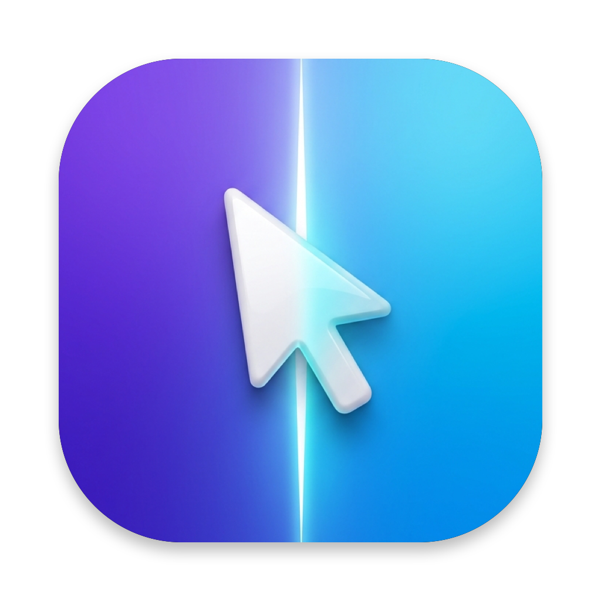
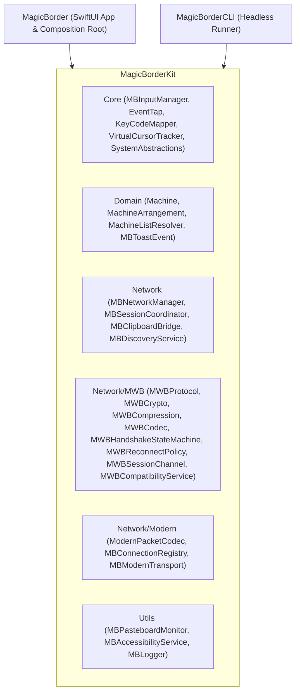

<p align="center">
  
</p>

<h1 align="center">MagicBorder</h1>

<p align="center">
  <strong>Native macOS software KVM, universal clipboard, and file-drop bridge compatible with Windows Mouse Without Borders.</strong>
</p>

<p align="center">
  <a href="https://github.com/Tinnci/MagicBorder/actions/workflows/ci.yml">
    
  </a>
  
  
  
  <a href="LICENSE">
    
  </a>
</p>

---

**MagicBorder** turns one keyboard and mouse into a seamless control surface across your Macs and Windows PCs over your local network. Built from the ground up with **Swift 6**, **SwiftUI**, **Network.framework**, **CryptoKit**, and **CommonCrypto** — with **zero external SwiftPM dependencies** — it speaks both Windows PowerToys **Mouse Without Borders (MWB)** and a native Mac-to-Mac protocol.

## Features

- **Cross-Platform KVM Control**: Glide your cursor across screen edges (1-row strip or 2×2 grid, optional wrap-around and corner blocking) to control Windows PCs running PowerToys Mouse Without Borders or fellow Macs.
- **Instant Escape Fail-Safe**: Press `Esc` at any time while controlling a remote machine to immediately return input focus to your local Mac.
- **Universal Clipboard & File Drop**: Sync text, PNG/TIFF images, and file drops across connected machines (with zlib compression in MWB compatibility mode).
- **Native macOS Experience**: SwiftUI dashboard (`NavigationSplitView` + inspector), menu bar extra, floating toast overlays, and drag-and-drop grid arrangement, localized in English and Simplified Chinese.
- **Zero-Dependency & Fast Builds**: Uses only Apple system frameworks (`CryptoKit`, `CommonCrypto`, `Compression`, `Network`, `ApplicationServices`, `OSLog`, `Observation`), building offline in seconds.
- **Headless CLI**: Includes `MagicBorderCLI` for terminal-based MWB compatibility sessions and diagnostics.

## Protocol Modes

| Capability | MWB Compatibility (`macOS ↔ Windows`) | Modern (`macOS ↔ macOS`) |
| --- | --- | --- |
| **Wire Format** | 32/64-byte binary packets (`MWBPacket`) | Length-prefixed JSON (`ModernPacketCodec`, 32 MB frame cap) |
| **Transport & Ports** | Dual TCP channels (`15101` message / `15100` clipboard, configurable) | TCP (`12345` default) + Bonjour (`_magicborder._tcp`) |
| **Discovery** | Bounded subnet port scan + manual IP entry | Bonjour (`NWBrowser`) + manual IP / endpoint |
| **Security** | PBKDF2-HMAC-SHA512 (50k rounds) + AES-256-CBC stream cipher + magic checksum | HMAC-SHA256 handshake authentication + HKDF-SHA256 / AES-256-GCM frame encryption |
| **Input Forwarding** | Relative or normalized mouse, middle click, scroll scaling/inversion, per-peer `⌘↔Ctrl` swap, stuck-modifier release | Normalized/absolute mouse, drag, scroll scaling/inversion, `CGKeyCode` |
| **Ergonomics & Controls** | Configurable Escape (`Double-Tap Esc` / `⌃⌥Esc`), custom global hotkeys, multi-monitor perimeter detection, Lock All Screens | Same |
| **Clipboard & Files** | UTF-16LE + zlib text, PNG images, file drag-drop, screen capture | UTF-8 text, image data |
| **Matrix Layout Sync** | 4-slot matrix sync (`twoRow` & `swap` flags) | Local arrangement |

## Architecture

MagicBorder separates pure domain logic, system abstractions, wire codecs, and SwiftUI presentation into strict SOLID layers:



- **`Sources/MagicBorderKit/Domain`**: Pure `Sendable` value types (`Machine`, `MachineArrangement`, `MachineListResolver`, `MBToastEvent`, `MBDragDropState`).
- **`Sources/MagicBorderKit/Core`**: `MBInputManager` (`CGEventTap` interception with timeout recovery), `MBKeyCodeMapper`, `MBRemoteEventConverter`, `MBVirtualCursorTracker`, `MBCGEventSynthesizer`, `MBCompatibilitySettings`, and testable system protocols (`ClockProviding`, `ScreenGeometryProviding`, `CursorControlling`, `PasteboardAccessing`, `ScreenCapturing`).
- **`Sources/MagicBorderKit/Network`**: Segregated transport protocols (`MBTransport`, `MBMatrixSyncTransport`, `MBFileDropTransport`, `MBRemoteActivationTransport`), `MBSessionCoordinator`, `MBClipboardBridge`, `MBDiscoveryService`, and `MBNetworkManager`.
- **`Sources/MagicBorderKit/Network/MWB`**: Decomposed Mouse Without Borders stack with off-`@MainActor` AES-CBC framing (`MWBChannelStreamProcessor` actor), streaming zlib compression, challenge-response handshake state machine, and reconnect policy.
- **`Sources/MagicBorder`**: SwiftUI macOS app acting as the single composition root, localization layer (`en`, `zh-Hans`), and toast/overlay presenter.

## Quick Start

### Requirements

- **macOS 14.0+** (Apple Silicon or Intel)
- **Swift 6.1+** (Xcode 16+ / Swift toolchain)
- **Accessibility permission** (System Settings → Privacy & Security → Accessibility) for HID input capture and event synthesis

### Build & Run

```bash
git clone https://github.com/Tinnci/MagicBorder.git
cd MagicBorder

# Build release binaries (zero external dependencies)
swift build -c release

# Launch the macOS app
.build/release/MagicBorder
```

Or run directly during development:

```bash
swift run MagicBorder
```

### Headless CLI

```bash
swift run MagicBorderCLI <WINDOWS_IP_ADDRESS> <SECURITY_KEY>
```

## Pairing with Windows (Mouse Without Borders)

1. **Install Mouse Without Borders** on Windows (standalone or via Microsoft PowerToys).
2. **Set a matching Security Key** (at least 16 characters, spaces ignored) in **Settings → Network** (or the Pairing inspector) on MagicBorder and in Mouse Without Borders on Windows.
3. **Allow firewall traffic** on TCP ports **`15100`** (clipboard) and **`15101`** (messages) on your Windows machine, and ensure both devices are on the same local subnet.
4. **Connect & Arrange**: Enter the Windows IP in the **Pairing** inspector (or pick a discovered peer) and click **Connect**, then drag machine cards into their physical layout in **Arrangement**.
   - Press **`Esc`** on your Mac at any time to force control back to your local machine.

## Development & Quality Gates

MagicBorder enforces Swift 6 strict concurrency and upcoming language features (`ExistentialAny`, `InternalImportsByDefault`, `MemberImportVisibility`) with zero warnings allowed in CI. Use the included `Makefile` (or run commands directly):

```bash
# Run full local CI gate (static checks, swift format lint, debug build, tests, TSan)
make check

# Individual checks & helpers
make format        # Format Swift sources and tests in place
make format-lint   # Strict swift-format lint
make static-check  # Localization key parity, Info.plist validation, architecture guardrails
make coverage      # Run Swift Testing suite and print MagicBorderKit llvm-cov report
make package       # Build Universal (arm64 + x86_64) MagicBorder.app and DMG into dist/
```

If [SwiftLint](https://github.com/realm/SwiftLint) is installed locally, you can also run `swiftlint lint --strict`.

## Release Packaging & Homebrew Cask

Create distributable Universal (`arm64` + `x86_64`) `.app` / CLI archives and a drag-to-Applications `.dmg` locally using [`scripts/release_package.sh`](scripts/release_package.sh):

```bash
CREATE_DMG=1 ./scripts/release_package.sh
```

Supported environment flags:

- `ARCH_MODE=universal|native` — build Universal (`arm64` + `x86_64`, default) or host-native binary
- `RELEASE_VERSION=0.1.0` — override bundle version (defaults to latest git tag)
- `CREATE_DMG=1` — build a compressed `.dmg` with an `/Applications` link
- `CREATE_PKG=1` — also build a `.pkg` installer
- `SIGN_IDENTITY="Developer ID Application: <Name>"` — codesign with hardened runtime & [`MagicBorder.entitlements`](Sources/MagicBorder/Resources/MagicBorder.entitlements)
- `NOTARY_PROFILE=<keychain-profile>` — notarize via `notarytool` and staple the `.app` bundle
- `PKG_SIGN_IDENTITY="Developer ID Installer: <Name>"` — codesign the `.pkg`

Artifacts and `SHA256SUMS.txt` are written to `dist/`. Pushing a `v*` tag triggers [`.github/workflows/release.yml`](.github/workflows/release.yml), which gates releases on full CI and attaches SLSA build provenance attestations. A Homebrew Cask formula template is maintained at [`Packaging/homebrew/magicborder.rb`](Packaging/homebrew/magicborder.rb).

> **Note:** Unsigned builds are blocked by macOS Gatekeeper on first launch; allow them in **System Settings → Privacy & Security** or sign with a Developer ID certificate.

## Security Notes

See [SECURITY.md](SECURITY.md) for responsible disclosure and full threat-model notes.

- **MWB Compatibility Mode** reproduces the legacy Mouse Without Borders cryptographic scheme (PBKDF2-HMAC-SHA512 key derivation + AES-256-CBC with a fixed IV derived from MWB's protocol constant) solely for interoperability with Windows MWB on trusted LANs.
- **Modern Mode** signs handshakes with HMAC-SHA256 (constant-time verification, rejecting missing/invalid signatures whenever a security key is configured) and enforces a 32 MB maximum frame size.
- Use MagicBorder only on trusted private networks with a strong 16+ character Security Key.

## Troubleshooting

- **Input is not forwarded**: Verify MagicBorder is enabled in **System Settings → Privacy & Security → Accessibility** and that **Capture Local Input** is toggled on.
- **Cannot connect to Windows PC**: Confirm both machines share the same Security Key (≥ 16 non-space characters), TCP ports `15100` and `15101` are open in Windows Firewall, and both devices are on the same subnet.
- **Stuck on remote machine**: Press **`Esc`** to force-return input control to your local Mac.

## Contributing & Community

Contributions are welcome! Please read [CONTRIBUTING.md](CONTRIBUTING.md) and our [Code of Conduct](CODE_OF_CONDUCT.md) before opening a Pull Request, and track notable changes in [CHANGELOG.md](CHANGELOG.md).

1. Fork the repository and create a feature branch.
2. Keep changes focused and well-tested (prefer injected abstractions over OS globals).
3. Ensure `make check` passes with zero errors or warnings before opening a Pull Request.

## License

Licensed under the **GNU General Public License v3.0 (GPL-3.0)**. See [LICENSE](LICENSE) for full details.
